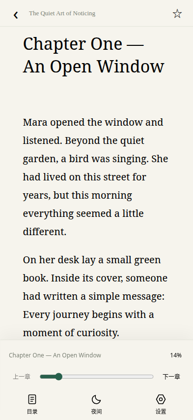
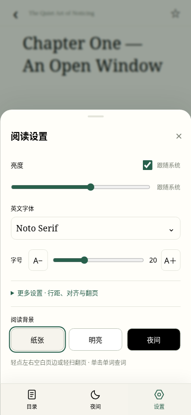
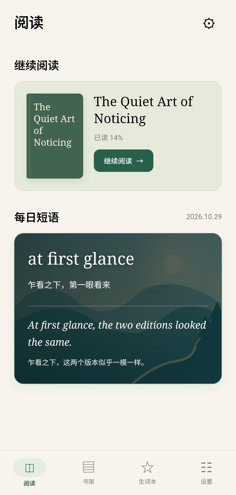
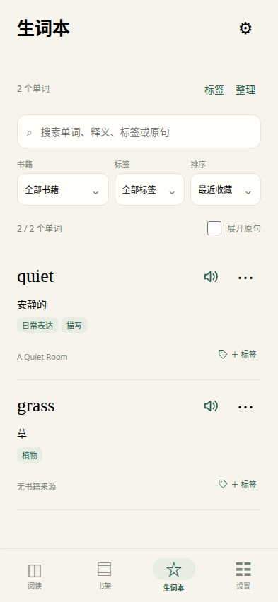

# 叶读 · Leaf

**让英文阅读更连贯，让词汇积累更自然。**

叶读是一款为英语学习者设计的 Android 英文阅读 App。无论是喜欢的小说，还是感兴趣的短文，你都可以在阅读时轻点生词，查看释义、听读音，再接着读下去。

我们希望查词自然地融入阅读，让你更容易沉浸在故事和内容中。随着读过的文章越来越多，把一次次遇见的生词留下来，在熟悉的语境中回看，逐渐扩大词汇量，也让自己更有信心读得更多。

[下载 Android 测试版](https://github.com/simon2949/leaf-reader/releases/tag/v0.1.13) · [查看更新](CHANGELOG.md) · [反馈问题与建议](https://github.com/simon2949/leaf-reader/issues)

## 在阅读中理解生词

遇到不认识的词，轻点即可在当前阅读页面查看中文释义或英文解释，也可以听美式发音。查询时会突出显示这个词和它所在的原句，帮助你结合上下文理解意思。

看完释义，收起词典，就能继续刚才的故事。查词、听音和收藏都在阅读过程中完成，减少切换应用和重新寻找阅读位置的打断。

## 让读过的内容成为自己的词汇积累

收藏一个单词时，也留下它所在的原句和书籍来源。回看时，你能重新想起它出现的情境；同一个词在不同内容中的遇见，也可以一起保存。

- **在语境中回看**：同时查看单词释义与原句，还可以返回原书继续阅读。
- **按自己的方式整理**：按书籍筛选，用标签归类，方便重温最近阅读中遇到的词。
- **在重逢时认出来**：已收藏的单词及常见词形可以显示下划线，帮助你留意它们再次出现。

让生词本与自己的阅读经历联系起来，为持续积累词汇提供一个方便的入口。

## 读自己感兴趣的内容，慢慢增加阅读量

把想读的英文小说和文章放进书架，从自己感兴趣的内容开始。阅读进度自动保存，下次打开就能继续；也可以通过每日短语，在零碎时间接触一点英文表达。

- **自己的英文书架**：支持导入 TXT、EPUB、MOBI、AZW、AZW3 格式的未加密书籍，也支持粘贴文章、通过网页链接导入正文。
- **适合自己的阅读方式**：可调整字体、字号、行距和页边距，切换日间或夜间模式；支持点击页边、滑动或音量键翻页。
- **随时接着读**：目录、书签和自动保存的进度，让每次阅读都更容易开始。

从一篇短文到一本小说，让阅读成为能够持续的小习惯。

## 离线也能安心阅读

书籍导入后，阅读、查词、生词回看和语音合成都可以离线使用，无需另外下载词典或合成语音包。

联网时会尝试获取真人美音，已缓存的录音可离线播放；没有可用录音时使用内置美音合成。合成声音较机械，部分单词可能没有真人录音。

无需注册，没有广告。书籍、阅读进度和生词保存在本机，支持导出与恢复备份。卸载前请先导出备份。更多说明见 [隐私说明](PRIVACY.md)。

## 看看叶读

<table><tr><td></td><td></td><td></td><td></td></tr></table>

截图使用自创演示文章，界面会随版本持续改进。

## 开始阅读

目前公开测试版为 **v0.1.13**，支持 Android 8.0 及以上。

1. 打开 [下载页面](https://github.com/simon2949/leaf-reader/releases/tag/v0.1.13)，在 **Assets** 中下载 `.apk` 文件并安装。
2. 导入一本英文书，或粘贴一篇想读的文章。
3. 开始阅读，遇到生词时轻点查询，想留下的词随手收藏。

下载无需登录 GitHub。当前为开发签名测试版，功能和格式兼容性仍会继续完善。暂不支持 PDF 和加密书籍；网页导入不支持需要登录或付费才能访问的内容。每日短语来自内置内容，按日期轮换。

## 一起改进叶读

欢迎分享阅读体验、[反馈问题](https://github.com/simon2949/leaf-reader/issues)，或参与开发。我们希望和英语学习者一起，让叶读成为更顺手、更容易坚持使用的阅读工具。

- [构建、预览与测试](docs/development.md) · [贡献指南](CONTRIBUTING.md) · [后续计划](ROADMAP.md)
- [第三方资源与许可](THIRD_PARTY_NOTICES.md) · [离线合成引擎源码](docs/offline-speech.md) · [安全问题反馈](SECURITY.md)

由 [simon2949](https://github.com/simon2949) 维护，源码按 [GPL-3.0-only](LICENSE) 开源；第三方组件和资源保留各自许可。
